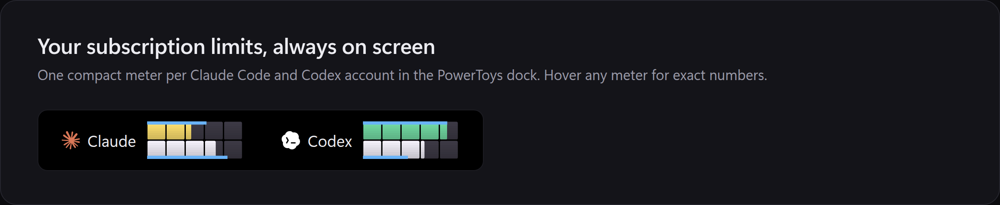
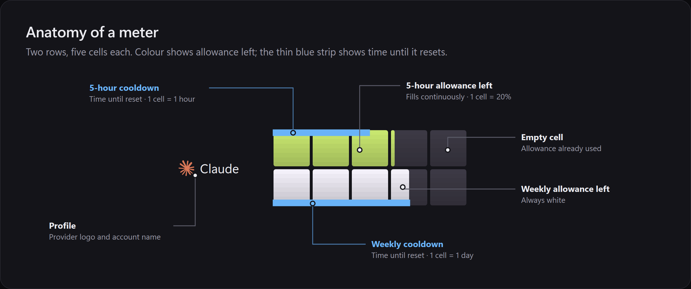
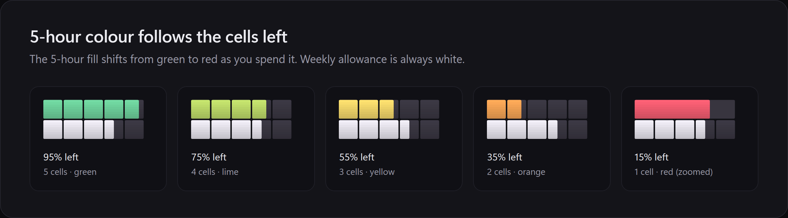
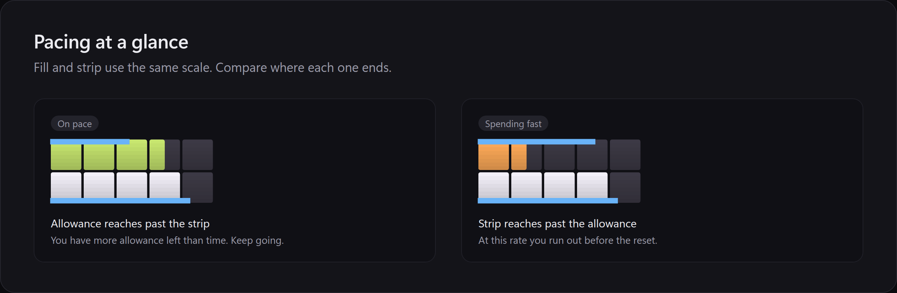
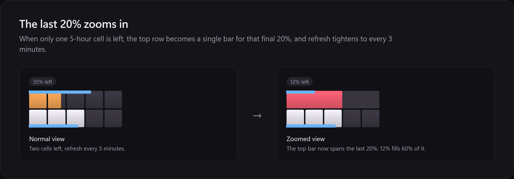
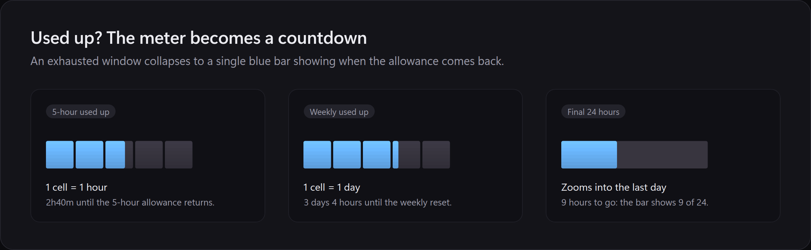
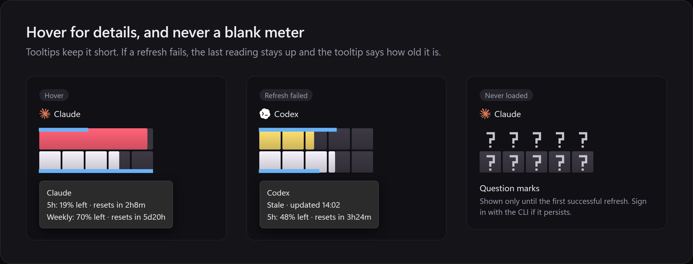

# Code Cooldown

**Claude Code and Codex limits in your PowerToys dock.**



A PowerToys Command Palette extension that shows your **Claude Code** and **Codex**
subscription allowance, read from the CLIs you already run in WSL. A live dock band
puts both limit windows (5-hour and weekly) at the top of your screen; the palette
command opens details, per-profile refresh and configuration.

Read-only by design: it never signs in, never sends model requests, and your
credentials never leave WSL.

## Reading the meter













## Requirements

- Windows 11 with [PowerToys](https://github.com/microsoft/PowerToys) and Command Palette
- .NET SDK 10 and a Windows SDK (19041 or newer) to build
- WSL with Python 3.11+
- Claude Code and/or Codex signed in inside WSL
- Windows **Developer Mode** on (Settings → System → For developers), needed to
  register a locally built package

## Install

From Windows PowerShell in this checkout:

```powershell
.\scripts\build.ps1 -Test
.\scripts\install.ps1 -Distro Ubuntu      # add -LinuxUser <name> for a non-default WSL user
.\scripts\pin-hud.ps1 -DefaultSize        # optional: pin the HUD to the dock
```

`install.ps1` installs the helper to `~/.local/share/code-usage-monitor` in WSL,
registers the extension for your Windows user, and restarts Command Palette. Each
install uses a fresh versioned folder under `%LOCALAPPDATA%`, because Windows keeps
loaded fonts locked. `-DefaultSize` switches the dock to its Default size, which
gives the meter more height. `pin-hud.ps1` backs up your Command Palette settings
before changing them.

Open Command Palette and run **Code Cooldown**, or pin **Code Cooldown HUD** from the dock
settings.

## Configure

On first install the helper looks for these accounts. It checks whether credential
files exist but never reads them:

| Location | Profile |
| --- | --- |
| `~/.claude/.credentials.json` (or `$CLAUDE_CONFIG_DIR`) | Claude |
| `~/.codex/auth.json` (or `$CODEX_HOME`) | Codex |
| `~/.claude-<name>/.credentials.json` | Claude (name) |
| `~/.codex-<name>/auth.json` | Codex (name) |

Use **Code Cooldown → Configure profiles** to rename, disable, delete or add profiles
(any credential path), and to choose between showing allowance **left** (default)
or **used**. Refresh defaults to five minutes per profile.

Settings and cached readings live only on your machine, in
`%LOCALAPPDATA%\CodeUsageMonitor`, readable by your Windows user alone. They are not
part of this repository.

## Privacy and security

- Credentials stay in WSL. The helper sends Windows only normalised numbers:
  percentages, reset times and status words. No tokens, emails or raw responses.
- The helper calls only the two fixed usage endpoints, refuses HTTP redirects,
  never executes shell commands, and never refreshes or changes your login.
- `wsl.exe` receives its arguments as a list, not through a shell. Requests and
  responses are size-bounded and time-limited.
- **Copy sanitized diagnostics** shares status and timestamps only, with hashed
  profile references.

The usage endpoints are unofficial and may change. A changed response shows as
"Unsupported response", never as invented numbers.

## Development

```bash
bash scripts/test.sh                       # helper tests (WSL)
```

```powershell
.\scripts\build.ps1 -Test                  # extension tests
$env:CODE_USAGE_WSL_HOME = '/home/<you>'; .\scripts\build.ps1 -TestWsl   # real WSL checks
.\scripts\smoke-ui.ps1                     # drives the installed extension via UI Automation
```

The dock meter is drawn with two bundled colour fonts. That is the only way to
paint a wide graphic inside the dock's native icon surface. Regenerate them with
`python3 scripts/generate-meter-font.py` (requires FontTools). README images are
rendered from `docs/images/src/readme.html` with the same fonts:
`python3 docs/images/src/render.py` (requires Chrome and Pillow). See
[docs/ARCHITECTURE.md](docs/ARCHITECTURE.md) for the transport, protocol and font
design.

## Uninstall

```powershell
Remove-AppxPackage (Get-AppxPackage CodeUsageMonitor).PackageFullName
```

Then delete `%LOCALAPPDATA%\CodeUsageMonitor*` and `~/.local/share/code-usage-monitor`
in WSL if you want no trace left. Your CLI logins are untouched.

## License

MIT. See [LICENSE](LICENSE). Claude and Codex/OpenAI marks belong to their owners and
are used only to identify the configured services; see
[THIRD-PARTY-NOTICES.md](THIRD-PARTY-NOTICES.md). Not affiliated with Anthropic,
OpenAI or Microsoft.
